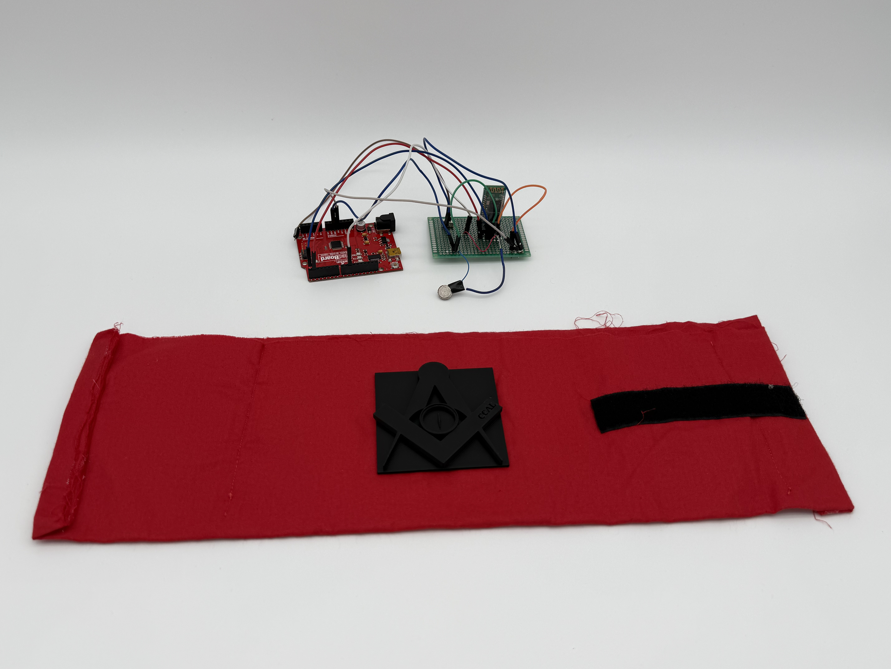
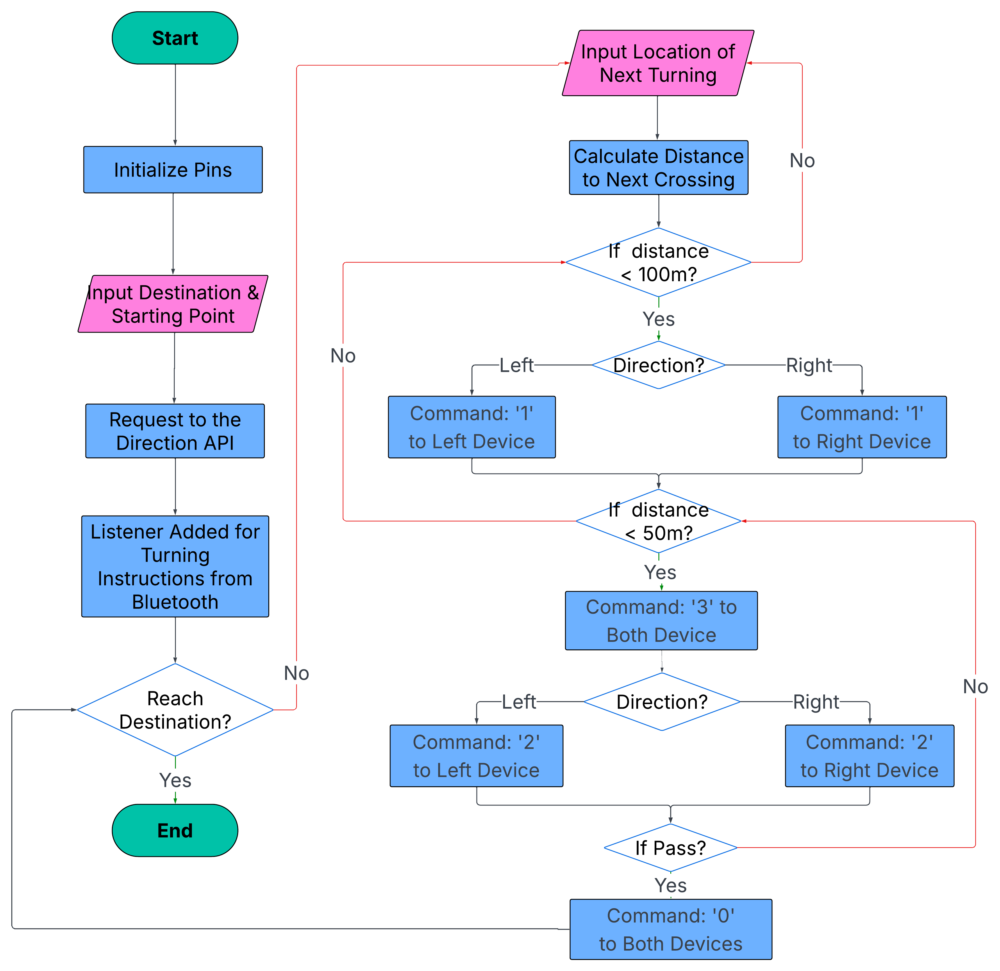

# VibeGuide · Haptic Navigation


**An Android + Arduino wearable prototype that turns navigation instructions into left/right vibration cues.**

**Fall 2025 · NYU Tandon EG 1004 team project · Updated for my portfolio in 2026**

[How it works](docs/ENGINEERING.md) · [My role](docs/CONTRIBUTIONS.md) · [Arduino firmware](firmware/vibeguide/vibeguide.ino) · [Local setup](SECURITY.md)

## The idea

I wanted to supplement on-screen navigation with physical feedback. VibeGuide uses an Android app to find a route, follow the phone's location, and send commands to left and right wearable vibration units. The side indicates the turn direction, while the vibration level changes with distance to the next waypoint.

This was a four-person course project in Fall 2025. I am now organizing the original software, firmware, and prototype materials for my portfolio.

## My role

I originated the concept and led feature planning and iterative development for the Android-to-Arduino prototype. I researched Bluetooth options, sourced components from the lab, and worked through the features step by step, testing and refining how the software and hardware behaved together.

I also participated hands-on throughout circuit assembly, completed approximately half of the soldering, and delivered the main technical explanation in our presentation. [More about my role →](docs/CONTRIBUTIONS.md)

I was responsible for the final simple functional test. We checked the connected prototype and confirmed that the basic navigation-to-vibration workflow worked.

## The physical prototype



*The team's 2025 prototype: Arduino Uno-class controller, Bluetooth serial module, coin-style vibration motor, enclosure, and wearable strap.*

## Distance → direction → command

The app measures straight-line distance to the next waypoint. During normal approach, it sends the intensity command to the side identified by the turn instruction and `0` to the other side.

| Distance | Left turn: L / R | Right turn: L / R |
| --- | --- | --- |
| More than 100 m | `0 / 0` | `0 / 0` |
| More than 50 m, up to 100 m | `1 / 0` | `0 / 1` |
| More than 10 m, up to 50 m | `2 / 0` | `0 / 2` |

Events override the normal approach commands:

- **First entering 50 m or closer:** request `3` on both sides as a warning.
- **Within 10 m of an intermediate waypoint:** request `3` on both sides, then advance to the next step.
- **Within 10 m of the final destination:** request `2` on both sides, then request `0` as navigation stops.

The app also sends a `3` test pulse followed by `0` when a device connects. It suppresses consecutive duplicate command requests. On steps without a recognized left/right instruction, the normal approach commands remain `0 / 0`.

## What the Arduino does

| ASCII command | Firmware behavior |
| --- | --- |
| `0` | Motor off |
| `1` | Low PWM level: `120 / 255` |
| `2` | High PWM level: `255 / 255` |
| `3` | Two brief high pulses, then off |

The firmware listens on `Serial` at **9600 baud** and uses **PWM pin 10**. Commands `0`, `1`, and `2` hold their state until a new command arrives. [Open the sketch →](firmware/vibeguide/vibeguide.ino)

## System flow



*Our original 2025 team flowchart.*

## Technical details

- **Android interface:** Compose map, destination search, route polyline, turn instructions, and separate left/right connection controls.
- **Navigation:** waypoint progression, turn-side selection from instruction text, distance-based intensity, and warning events.
- **Hardware interface:** two Bluetooth Classic RFCOMM connections, single-byte ASCII commands, and Arduino PWM output.
- **Demo controls:** command display and a wall-test mode with a button to advance the simulated position by 5 m.
- **Configuration:** Maps key and left/right device addresses supplied through ignored `local.properties`.

[Implementation notes and possible next steps →](docs/ENGINEERING.md)

## Run locally

1. Open the project in Android Studio with JDK 17 or newer and Android SDK 36. The project uses Gradle 8.13, Android Gradle Plugin 8.13.0, and Kotlin 2.0.21.
2. Copy `local.properties.example` to `local.properties`, and set your own Maps key and **left/right** Bluetooth addresses. Let Android Studio set `sdk.dir`.
3. Enable Maps SDK for Android and the Directions API for your Google Cloud project. See [configuration notes](SECURITY.md) for key restrictions.
4. Open `firmware/vibeguide/vibeguide.ino` in Arduino IDE for the corresponding Uno-class receiver. Match the prototype's motor circuit and Bluetooth serial setup.
5. Pair a physical Android phone with the Bluetooth Classic SPP receivers. Enable location, Bluetooth, internet access, and the requested permissions.
6. Use **Connect Left** / **Connect Right**, search for a destination, and choose **Go**. The app permits starting with at least one side connected; connect both to demonstrate both turn directions.

```sh
./gradlew assembleDebug
```

The app supports Android 7.0 / API 24 and newer.

## Code guide

| File | Contents |
| --- | --- |
| [`MainActivity.kt`](app/src/main/java/com/example/hapticnav/MainActivity.kt) | Compose UI, two Bluetooth connections, route requests, location, and cue selection |
| [`HapticCueController.kt`](app/src/main/java/com/example/hapticnav/HapticCueController.kt) | Distance thresholds and timed warning, waypoint, and arrival cues |
| [`vibeguide.ino`](firmware/vibeguide/vibeguide.ino) | Stateful PWM motor control and warning pulses |
| [`app/build.gradle.kts`](app/build.gradle.kts) | Dependencies and local configuration injection |
| [`AndroidManifest.xml`](app/src/main/AndroidManifest.xml) | App permissions and Maps configuration |

## Next steps

I'd focus further work on handling GPS noise, structured turn instructions, and reconnect behavior. This version is a functional course-project prototype with simple testing.
